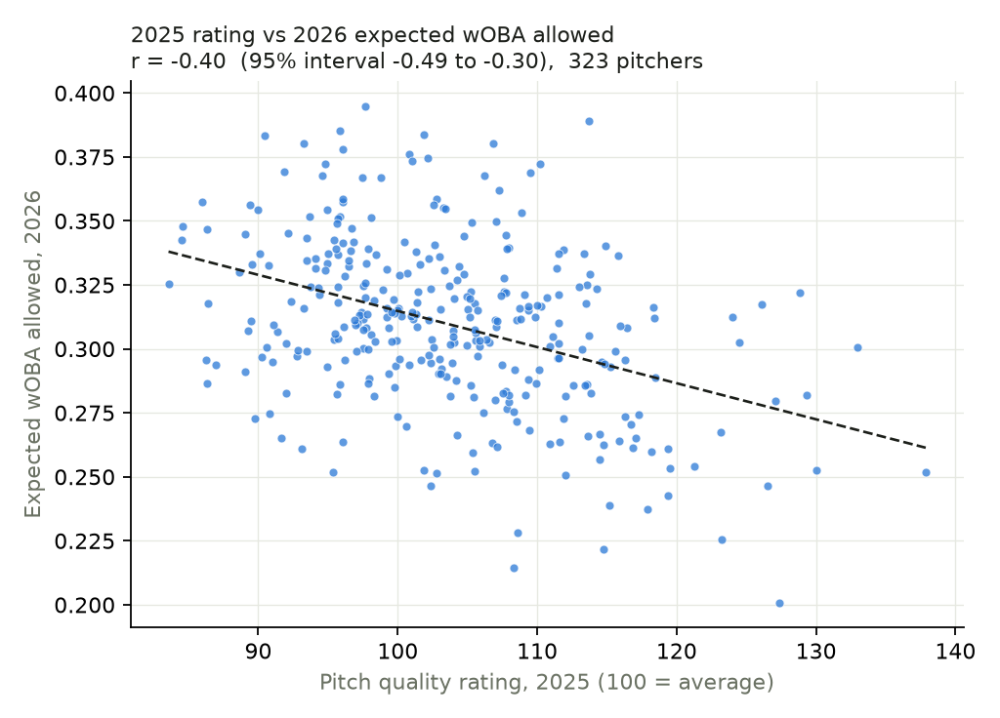

# Pitch Quality Model

**Does the shape of a pitch say something about next season that this season's results do not?**

An independent baseball research project by Daiki Takizawa. Public Statcast data, a model that
never sees the seasons it is judged on, and intervals on every headline number. No affiliation
with MLB or any club.

[](https://github.com/takizawadaiki/pitch-quality-model/actions/workflows/tests.yml)

## Status

Run on Statcast data retrieved 11 November 2026: 4.24 million regular-season pitches from 2021
to 2026. Every number below comes from that run and is in `results/`.

## Findings

323 pitchers threw at least 500 pitches in both 2025 and 2026. Intervals are 95%, from
resampling pitchers.

1. **The rating is stable.** Agreement between two halves of a pitcher's 2025 games projects to
   0.99 over a full season, against 0.30 for actual runs prevented per 100 pitches. From 2025
   to 2026 the rating correlates with itself at 0.89.
2. **On its own it predicts next season about as well as expected wOBA, and less well than
   strikeout-minus-walk rate.** The 2025 rating against 2026 expected wOBA allowed: r = −0.40
   (−0.49 to −0.30); 2025 expected wOBA itself: +0.43 (0.33 to 0.52). Against 2026
   strikeout-minus-walk rate: rating +0.41 (0.31 to 0.50); the 2025 rate itself +0.55
   (0.46 to 0.62).
3. **Added to this season's results, it helps a little.** Out-of-sample error for 2026
   strikeout-minus-walk rate fell from 0.0497 to 0.0481 (change −0.0015, interval −0.0030 to
   −0.0001), and for expected wOBA from 0.0297 to 0.0288 (−0.0009, interval −0.0017 to
   −0.0001). For runs prevented the interval includes zero (−0.033 to +0.004).
4. **How much weight to put on this.** Both intervals only just exclude zero, three targets
   were tested, and on the development pair (2024 to 2025) the same gains were smaller with
   intervals that include zero. This is modest evidence that pitch shape adds information
   beyond one season of results. It is not a strong result.

Against the criteria written down in advance: the second (lower error with an interval that
excludes zero for at least one target) is met; the first (a link at least as strong as the
results-based measures) holds for expected wOBA and runs prevented but not for
strikeout-minus-walk rate.

The 2025 leaderboard looks like baseball: Trevor Megill, Ryan Helsley, Graham Ashcraft,
Emmanuel Clase and Aroldis Chapman lead it, and the highest-rated single pitch is Devin
Williams' changeup.

**Known weakness.** On single pitches the model explains 0.35% of run-value variance in the
seasons it trained on and 0.05% to 0.07% in later ones. Single pitches are mostly luck, so
small numbers are expected, but the gap says the model is fitting some noise. Stronger
regularisation is the first thing to try.



## The idea in one paragraph

Every pitch is rated using only how it left the hand: velocity, movement, spin, release point,
and how it differs from that pitcher's own fastball. The model learns from 2021 to 2023 what
those shapes were worth in runs. It then rates every 2025 pitch, and those ratings are judged
against what the same pitchers did in 2026, next to the obvious alternative of just using
their 2025 results. The full design is in [RESEARCH_PLAN.md](RESEARCH_PLAN.md), written before
any real data was run.

## Run it

**On GitHub, no setup.** Open the **Actions** tab, choose **Run analysis**, press **Run
workflow**. It downloads the data, trains, evaluates and commits the `results/` folder.

**In Google Colab.** Open
[`notebooks/pitch_quality.ipynb`](https://colab.research.google.com/github/takizawadaiki/pitch-quality-model/blob/main/notebooks/pitch_quality.ipynb)
and choose Runtime, Run all.

**On a computer with Python 3.10+.**

```sh
pip install -r requirements.txt
python -m pytest -q          # 15 checks, a few seconds
python run.py all            # download, prepare, train, evaluate
```

The first run downloads six seasons of pitches and takes a while. Months already downloaded
are skipped, so an interrupted run can be started again.

## What comes out

| File in `results/` | What it is |
|---|---|
| `summary.md` | The headline numbers in three tables |
| `metrics.json` | Every number, with intervals, for both season pairs |
| `leaderboard.csv` | 2025 pitchers ranked by rating (100 = average, 10 points = one standard deviation) |
| `pitch_types.csv` | Each pitcher's individual pitches, with velocity and movement |
| `pitcher_seasons.csv` | One row per pitcher-season, rating and results side by side |
| `model_report.json` | Training sizes, error by season, which inputs mattered |
| `data_manifest.json` | When the data was retrieved and how many pitches per season |
| two `.png` figures | Rating against next season; which measure predicts best |

## How the code guards against fooling itself

| Risk | Guard |
|---|---|
| Training on the future | Seasons are ordered in `config.py`; training asserts it; a test checks the model report |
| Results leaking into inputs | A test scrambles every outcome column and requires identical inputs |
| Sign of run value flipping | The pipeline stops unless strikeouts are negative and home runs positive |
| Handedness errors | A test builds a mirror-image left- and right-hander and requires identical inputs |
| Mistaking noise for signal | Every correlation and every change in error carries a 95% interval from resampling pitchers |
| Arithmetic slips | Plate-appearance statistics are checked against a case worked by hand |
| Test data read as findings | Output from made-up data goes to a separate, git-ignored folder |

## Layout

```
config.py            every choice that defines the study
run.py               command line entry point
pitchq/download.py   Statcast download, month by month, resumable
pitchq/prepare.py    cleaning and model inputs
pitchq/model.py      training and scoring
pitchq/evaluate.py   pitcher-level tests against next season
pitchq/synthetic.py  made-up data with a planted answer, for tests only
tests/               15 checks
notebooks/           Colab walkthrough
```

## Limits

Listed in full in [RESEARCH_PLAN.md](RESEARCH_PLAN.md). The main ones: no location, so this
measures stuff and not command; the run-value target depends on the count and the model is not
told the count; and pitchers who qualify in consecutive seasons are a selected group.

## Data and credit

Pitch data: [Baseball Savant](https://baseballsavant.mlb.com/), MLB Advanced Media, retrieved
with [pybaseball](https://github.com/jldbc/pybaseball). Rating pitches from their physical
characteristics is an established idea in public baseball analysis; this project is an
independent implementation with its own validation design.
